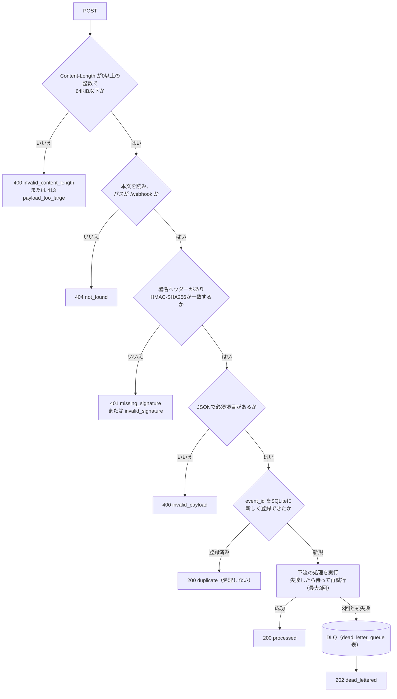

# fde-saas-webhook-bridge：署名検証・冪等性・リトライ・DLQを備えたWebhook受信サーバー（Python標準ライブラリのみ）

[](https://github.com/takashi-101/fde-saas-webhook-bridge/actions/workflows/tests.yml)

Webhook（あるシステムで起きた出来事を、HTTPのPOSTで別のシステムへ知らせる仕組み）を受け取る、汎用の受信サーバーです。特定のSaaSとの連携は実装していません。通知の形式は架空のもので、下流の処理（通知を受けて実際に行う処理）はデモ用の代わりの処理です。

## 30秒で読む要点
- **1コマンドで端から端まで確認できます**：`python -m webhook_bridge demo` が、`http.server`（標準ライブラリのHTTPサーバー）を127.0.0.1（自分のPCの中だけで通信するアドレス）で起動し、`urllib`（標準ライブラリのHTTPクライアント）で自分自身へ7件の通知を送り、10項目の結果を照合して表示します。1項目でも合わなければ終了コード1で終わります。
- **署名検証**：受信した本文のバイト列に対してHMAC-SHA256（共有の秘密鍵と本文から計算する、改ざん検知用の値）を計算し、`hmac.compare_digest`（内容によって比較時間が変わらない比較）で照合します。署名が無い・合わない通知は401で拒否し、処理も記録もしません。
- **冪等性・リトライ・DLQ**：同じ `event_id` の通知は1回だけ処理します（冪等性：同じ通知を何度受け取っても、処理は1回だけになる性質）。受信の記録はSQLite（ファイル1つで動くデータベース）に残すため、再起動後も重複を検知します。処理の失敗は最大3回まで指数バックオフ（再試行のたびに待ち時間を倍にする方法）で再試行し、それでも失敗した通知はDLQ（デッドレターキュー：処理できなかった通知を退避しておく場所）に移します。
- **標準ライブラリのみ**：外部パッケージ、有料API、APIキー、外部への通信を使いません。テストは26件です。CI（変更のたびにテストを自動で実行する仕組み）では、Python 3.11と3.12でテストとデモを実行します。

## 処理の流れ


`event_id` の登録は `INSERT OR IGNORE`（主キーが既にあれば何もしない挿入）の1回の操作で行うため、同じ通知が同時に届いても、下流の処理は1回だけです（10件同時に送るテストで確認しています）。

## HTTPの応答
| 状況 | HTTP | 応答の `status` |
|---|---|---|
| 処理に成功した | 200 | `processed` |
| 同じ `event_id` を受信済み（処理しない） | 200 | `duplicate` |
| 再試行しても失敗し、DLQに移した | 202 | `dead_lettered` |
| 署名ヘッダーが無い | 401 | `missing_signature` |
| 署名が一致しない | 401 | `invalid_signature` |
| 本文がJSONでない、必須項目が無い | 400 | `invalid_payload` |
| `Content-Length` が数値でない、または負 | 400 | `invalid_content_length` |
| 本文が64KiB（65,536バイト）を超える | 413 | `payload_too_large` |
| パスが `/webhook` 以外 | 404 | `not_found` |

- 表の応答の本文はJSONです。`processed`・`duplicate`・`dead_lettered` には `event_id` と `attempts`（今回の受信で下流の処理を呼んだ回数。重複は0）が付きます。
- `duplicate` には `previous_status`（最初に受け取ったときの結果）、`dead_lettered` には `last_error`（最後の失敗の内容）が付きます。
- DLQに移した通知に202を返すのは、受け取り自体は完了しており、送信側が再送する必要がないためです。
- 受け付けるのは `POST` だけです。それ以外のメソッドには、`http.server` の既定の501（本文はHTML）を返します。

## 通知の形式（架空）
```json
{
  "event_id": "evt-2001",
  "type": "ticket.created",
  "data": {
    "ticket_id": "T-2001",
    "subject": "sample inquiry (fictitious)"
  }
}
```
| 項目 | 条件 |
|---|---|
| `event_id` | 1〜200文字の文字列。重複判定のキー（冪等性キー）です |
| `type` | 空でない文字列 |
| `data` | JSONオブジェクト。中身は検査しません |

- **署名**：ヘッダー `X-Webhook-Signature: sha256=<16進小文字64桁>`。値は、送られてきた本文のバイト列そのものに対するHMAC-SHA256です（JSONを解釈し直した値ではありません）。
- **秘密鍵**：環境変数 `WEBHOOK_SECRET` の値を使います。未設定のときは、コードに書いた架空のデモ用の値（`demo-secret-not-for-production`）を使い、`serve` は警告を表示します。受信側（`serve`）と送信側（`send`）には同じ値を設定してください。
- **デモ用の下流の処理**（`webhook_bridge/demo.py` の `DemoDownstream`）：呼び出し回数を数えるだけです。`data.simulate` が `fail_once` なら1回目だけ、`always_fail` なら毎回、例外を出します。

## 実行
要件：Python 3.11以上。標準ライブラリのみなので `pip install` は不要です。リポジトリのルートで実行します。

### デモ（1コマンド）
```
python -m webhook_bridge demo
```
実行結果（Windows、Python 3.14.6）：
```
webhook-bridge demo
  database : demo.db (deleted and recreated for this run)
  server   : http.server bound to 127.0.0.1, ephemeral port, POST /webhook
  secret   : built-in demo value (WEBHOOK_SECRET is not set)
  retry    : up to 3 attempts, waits 0.05 s x 2^(n-1) between them

 #  case                      event_id  HTTP  status             attempts  check
 1  valid signature           evt-1001   200  processed                 1  ok
 2  same event again          evt-1001   200  duplicate                 0  ok
 3  signed with wrong secret  evt-1002   401  invalid_signature         -  ok
 4  no signature header       evt-1002   401  missing_signature         -  ok
 5  fails once, then retried  evt-1003   200  processed                 2  ok
 6  always fails              evt-1004   202  dead_lettered             3  ok
    -- server stopped and started again on the same SQLite file --
 7  same event after restart  evt-1001   200  duplicate                 0  ok

summary
  handler calls per event : evt-1001=1, evt-1002=0, evt-1003=2, evt-1004=3  [ok]
  events table by status  : dead_lettered=1, processed=2  [ok]
  dead-letter queue       : 1 event(s)  [ok]
    evt-1004  ticket.created  attempts=3  last_error=RuntimeError: downstream unavailable (demo)
  result                  : 10/10 checks passed
```
- サーバーはエフェメラルポート（OSが空いている番号を自動で割り当てるポート）で待ち受けます。
- 3と4は署名で拒否したため、`evt-1002` は処理も記録もしていません（`evt-1002=0`）。
- 5は1回目が失敗し、0.05秒待って2回目で成功しました。6は3回とも失敗し（間に0.05秒と0.1秒待機）、DLQに移しました。
- 7は、サーバーを停止してから同じSQLiteファイルで作り直して送りました（同じプロセスの中での停止と再作成です）。最初の受信の記録が残っているため、重複と判定しました。
- デモは `demo.db` を毎回削除して作り直すので、何度実行しても同じ結果になります。`--db` で別のファイルを指定できます（そのファイルも削除して作り直します）。

### DLQの一覧
```
python -m webhook_bridge dlq --db demo.db
```
実行結果：
```
1 dead-lettered event(s) in demo.db
  evt-1004  ticket.created  attempts=3  last_error=RuntimeError: downstream unavailable (demo)  at=2026-11-14T09:12:44+00:00
```
`--payload` を付けると、保存した通知の本文も表示します。

### サーバーとして動かす
```
python -m webhook_bridge serve --port 8080 --db bridge.db
```
別の端末から、見本の通知を送ります（同じ通知を2回送り、次に毎回失敗する通知を送ります）：
```
python -m webhook_bridge send samples/event_ok.json --port 8080
python -m webhook_bridge send samples/event_ok.json --port 8080
python -m webhook_bridge send samples/event_always_fail.json --port 8080
python -m webhook_bridge dlq --db bridge.db
```
実行結果（`bridge.db` が無い状態から）：
```
HTTP 200 {"status": "processed", "event_id": "evt-2001", "attempts": 1}
HTTP 200 {"status": "duplicate", "event_id": "evt-2001", "attempts": 0, "previous_status": "processed"}
HTTP 202 {"status": "dead_lettered", "event_id": "evt-2002", "attempts": 3, "last_error": "RuntimeError: downstream unavailable (demo)"}
1 dead-lettered event(s) in bridge.db
  evt-2002  ticket.created  attempts=3  last_error=RuntimeError: downstream unavailable (demo)  at=2026-11-14T09:12:37+00:00
```
- `serve` は127.0.0.1でだけ待ち受けます（アドレスは変更できません）。Ctrl+Cで停止します。
- `serve` の再試行は、既定で最大3回、待ち時間は0.5秒と1秒です（`--max-attempts`、`--base-delay` で変更できます）。
- `send` はファイルの中身をそのまま本文にして署名し、`http://127.0.0.1:<port>/webhook` へ送ります。2xx以外の応答なら終了コード1で終わります。
- `bridge.db` は残るため、同じ手順をもう一度実行すると、1件目から `duplicate` になります。

### テスト
```
python -m unittest discover -s tests -v
```

## テスト（26件）
| ファイル | 内容 |
|---|---|
| `tests/test_signature.py`（5件） | 正しい署名を受け付ける。本文の改ざん、別の秘密鍵、ヘッダーの欠落や形式違い（`sha256=` が無い、大文字の16進、ASCII以外の文字）を拒否する。環境変数で秘密鍵を変えられる |
| `tests/test_bridge.py`（5件） | 重複は1回だけ処理する。同じSQLiteファイルで作り直した後も重複を検知する。1回失敗した処理が再試行で成功する（待ち時間0.05秒）。3回失敗した処理がDLQに入る（待ち時間0.05秒・0.1秒、保存した本文、再送しても再処理しない）。不正な本文を拒否する |
| `tests/test_http.py`（12件） | 実際のサーバーをエフェメラルポートで起動し、`urllib` と `http.client` で送る。127.0.0.1で待ち受ける。200・401（署名なし・不一致、どちらも記録しない）・重複・再試行・202（DLQ）・400・404・413・501（GET）、`Content-Length` の不正。同じ通知を10件同時に送っても処理は1回 |
| `tests/test_cli.py`（4件） | `demo` が10/10で終了コード0、照合が合わなければ終了コード1。`send` で `samples/` の通知を送れる。`dlq` は存在しないファイルを作らずに終了コード1を返す |

SQLiteへの接続は操作ごとに開いて必ず閉じるため、Windowsでもテスト後に一時ファイルを削除できます。

## SQLiteの表
| 表 | 列 |
|---|---|
| `events` | `event_id`（主キー）、`event_type`、`status`（`processing` / `processed` / `dead_lettered`）、`attempts`、`received_at`、`updated_at` |
| `dead_letter_queue` | `event_id`（主キー）、`event_type`、`payload`（通知の本文のJSON）、`attempts`、`last_error`、`dead_lettered_at` |

時刻はUTCのISO 8601形式で記録します。

## 制約
- 下流の処理はデモ用の代わりで、外部のシステムには何も送りません。実際に使うには、`WebhookBridge` に渡す関数（handler）を差し替えます。
- 再試行は、HTTPのリクエストを処理している間に行います。待ち時間の合計だけ、送信側への応答が遅れます。
- 例外の種類（一時的か恒久的か）は区別せず、すべて再試行の対象です。
- DLQに移した通知を同じ `event_id` で再送しても、重複として扱い、再処理しません。DLQから再処理する機能はありません。
- 下流の処理と、SQLiteへの「処理済み」の記録は、1つのトランザクション（複数の書き込みを、すべて反映するか何も反映しないかにまとめる仕組み）ではありません。処理中にプロセスが止まると、その `event_id` は `processing` のまま残り、以後は重複として扱われます。
- 署名にタイムスタンプを含めていないため、同じ通知の再送（リプレイ）は `event_id` の重複判定でのみ防ぎます。
- 本文の長さは `Content-Length` で判断します。`Transfer-Encoding: chunked`（長さを先に示さない送り方）には対応していません。
- HTTPSには対応していません。127.0.0.1でのみ待ち受けるため、他のPCからの通信は受けません。

## ファイル構成
```
webhook_bridge/
  server.py      http.server による受信（127.0.0.1のみ、POST /webhook）
  signature.py   HMAC-SHA256 の署名と検証、秘密鍵の読み込み
  bridge.py      通知の検証、冪等性、再試行（指数バックオフ）、DLQへの移動
  store.py       SQLite（events、dead_letter_queue の2表）
  client.py      urllib による送信（127.0.0.1のみ、プロキシ設定を使わない）
  demo.py        デモ（下流の処理の代わり、送る通知、結果の照合）
  __main__.py    コマンド（demo、serve、send、dlq）
samples/         送信用の通知の見本（架空）
tests/           ユニットテスト（unittest）
.github/workflows/tests.yml   CI（Python 3.11、3.12でテストとデモを実行）
```

## 根拠（学習）

| 機能 | 裏付けになる学習（発行元・名称・発行日） | 照会先（Credly） |
|---|---|---|
| HMAC-SHA256による署名検証 | Coursera「Google Cybersecurity Professional Certificate(v.2)」2026年11月12日 | https://www.credly.com/badges/90bbb775-f9b8-4aef-bc24-1ed7c67d17e4 |
| 冪等性・リトライ・DLQ（処理できなかった通知の退避先） | Amazon Web Services Training and Certification「AWS Knowledge: Events and Workflows - Training Badge」2025年5月14日 | https://www.credly.com/badges/c575ff2b-80a7-4433-99d5-f26eeb7cda15 |
| 受信記録のSQLiteへの保存 | Amazon Web Services Training and Certification「AWS Educate Getting Started with Databases - Training Badge」2025年6月1日 | https://www.credly.com/badges/0f3404b3-6419-4d48-934f-507f0364e032 |

## ライセンス
MIT
